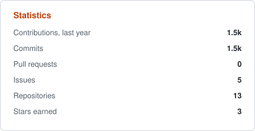
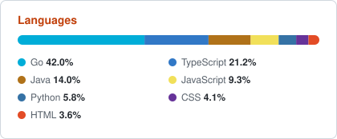
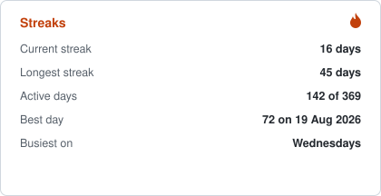

<h1 align="center">Dschonas04</h1>

  Self-hosted software from my own homelab: Go on the backend, React in the browser, 
  Kotlin on Android and Java for Minecraft mods. Plus photography.

  <a href="https://www.jonasgroll.de">www.jonasgroll.de</a> ·
  <a href="https://photo.jonasgroll.de">photo.jonasgroll.de</a> ·
  <a href="https://dschonas04.github.io/Nexora/">Nexora</a>

  <picture>
    <source media="(prefers-color-scheme: dark)" srcset="karten/terminal-dunkel.svg">
    
  </picture>

---

## About me

I build applications that run on your own server instead of someone else's cloud:
one Go binary, one database, one container, done. Everything runs in my homelab
first (Proxmox, Docker, Kubernetes with k3s, Ansible) and only lands here once it
has proven itself in daily use. Along the way I write mods for our Minecraft
server and workshops for anyone who wants to get started. My photos are at
[photo.jonasgroll.de](https://photo.jonasgroll.de).

  <picture>
    <source media="(prefers-color-scheme: dark)" srcset="karten/schrank-dunkel.svg">
    
  </picture>

---

## Everyday apps

| Project | What it does | Stack | Status |
| --- | --- | --- | --- |
| [Nexora](https://github.com/Dschonas04/Nexora) | Wiki with backlinks, knowledge graph, templates and Mermaid diagrams; [live demo](https://nexora.jonasgroll.de) | Go, React, PostgreSQL | [v3.7.1](https://github.com/Dschonas04/Nexora/releases/latest) |
| [Planr](https://github.com/Dschonas04/planr) | Plan floor plans and whole houses to scale, with a 3D view and DXF, SVG and PNG export | Go, React, three.js | [v2.1.0](https://github.com/Dschonas04/planr/releases/latest) |
| [Blankr](https://github.com/Dschonas04/blankr) | Shared whiteboard with live cursors and two share links: draw or watch | Go, React, WebSocket | [v1.1.0](https://github.com/Dschonas04/blankr/releases/latest) |
| [Foodr](https://github.com/Dschonas04/foodr) | Meal planner: weekly plan from a local language model, shopping list, nutrition data from BLS 4.0 | Go, PostgreSQL, Ollama | [v1.0.0](https://github.com/Dschonas04/foodr/releases/latest) |
| [Captr](https://github.com/Dschonas04/captr) | Develop photos in the browser, similar to Lightroom: RAW, JPEG, HEIC, non-destructive | Go, React, WebGL2 | [v1.0.0](https://github.com/Dschonas04/captr/releases/latest) |
| [Photr](https://github.com/Dschonas04/photr) | Create, design and share photo collections | Go, React, PostgreSQL | [v1.0.0](https://github.com/Dschonas04/photr/releases/latest) |
| [Meetr](https://github.com/Dschonas04/meetr) | Video calls in the browser on your own server, guests need no account | Go, WebRTC | in progress |

## Tools

**Network and devices**

| Project | What it does | Stack | Status |
| --- | --- | --- | --- |
| [Bondr](https://github.com/Dschonas04/bondr) | Use every internet connection at once: Ethernet, Wi-Fi, mobile data; per-connection data usage | Go; Windows, macOS, Linux, Android | [v3.3.1](https://github.com/Dschonas04/bondr/releases/latest) |
| [Sendr](https://github.com/Dschonas04/sendr) | Send files across the local network, no cloud, with TLS and resume after interruptions | Go; Windows, macOS, Linux | [v1.1.1](https://github.com/Dschonas04/sendr/releases/latest) |
| [Spotr](https://github.com/Dschonas04/spotr) | Turn an Android phone into a reliable hotspot: always on, schedules, off when at home | Kotlin, Android | in progress |

**Servers and teams**

| Project | What it does | Stack | Status |
| --- | --- | --- | --- |
| [Boardr](https://github.com/Dschonas04/boardr) | Homelab start page: services as tiles with status and widgets | Go | in progress |
| [Trailr](https://github.com/Dschonas04/trailr) | Audit log of who does what on Linux systems, with a hash chain against tampering | Go | in progress |
| [Forgr](https://github.com/Dschonas04/forgr) | Self-hosted Git with merge requests, issues and CI status | Go | in progress |
| [Ticketr](https://github.com/Dschonas04/ticketr) | Ticket system with email intake, queues and deadlines | Go, PostgreSQL | in progress |
| [Pagr](https://github.com/Dschonas04/pagr) | Content management for small websites: write, schedule, publish | Go | in progress |

## Minecraft

Mods for Minecraft Java on Fabric, made for our own server.

  <picture>
    <source media="(prefers-color-scheme: dark)" srcset="karten/tnt-dunkel.svg">
    
  </picture>

| Project | What it does | Status |
| --- | --- | --- |
| [TNT Arsenal](https://github.com/Dschonas04/TNT-Arsenal) | 64 kinds of TNT with their own textures, from drill charges to a nuke | [v1.8.1](https://github.com/Dschonas04/TNT-Arsenal/releases/latest) |
| [Fishr](https://github.com/Dschonas04/fishr) | Fishing with a real fight, 64 fish species, bait and boss fish | [v1.0.0](https://github.com/Dschonas04/fishr/releases/latest) |
| [Managr](https://github.com/Dschonas04/managr) | Server mod for loot, spawn protection and administration, plus data packs and scripts | [v3.1.0](https://github.com/Dschonas04/managr/releases/latest) |

## Learning: workshops

Self-paced workshops (in German), all in the
[workshop](https://github.com/Dschonas04/workshop) repository. Each one is made of
levels with theory, a task and a checker that tells you right away whether your
solution works.

| Workshop | Contents |
| --- | --- |
| [Go](https://github.com/Dschonas04/workshop/tree/main/go) | four levels, checked with `go test -race` |
| [React](https://github.com/Dschonas04/workshop/tree/main/react) | four levels, checked with Vitest and TypeScript |
| [Container](https://github.com/Dschonas04/workshop/tree/main/container) | Docker, Compose and Podman in five levels |
| [Ansible](https://github.com/Dschonas04/workshop/tree/main/ansible) | four levels against your own machine |
| [Terraform](https://github.com/Dschonas04/workshop/tree/main/terraform) | Terraform and OpenTofu in four levels, no cloud account needed |
| [Shell](https://github.com/Dschonas04/workshop/tree/main/shell) | Bash step by step in five levels |
| [PowerShell](https://github.com/Dschonas04/workshop/tree/main/powershell) | PowerShell from zero in nine levels |

---

## Stack

| Area | What I work with |
| --- | --- |
| Backend | Go, REST and WebSocket, PostgreSQL, SQLite |
| Frontend | React, TypeScript, Vite, WebGL2, three.js |
| Mobile and desktop | Kotlin for Android, desktop apps for Windows, macOS and Linux |
| Minecraft | Java, Fabric, Mixin, data packs |
| Operations | Docker, Kubernetes (k3s), Ansible, Terraform and OpenTofu, GitHub Actions |
| Homelab | Proxmox, Prometheus, Grafana, Pi-hole, Home Assistant, Ollama for local language models |

---

## Numbers

  <picture>
    <source media="(prefers-color-scheme: dark)" srcset="karten/statistik-dunkel.svg">
    
  </picture>
  <picture>
    <source media="(prefers-color-scheme: dark)" srcset="karten/sprachen-dunkel.svg">
    
  </picture>

  <picture>
    <source media="(prefers-color-scheme: dark)" srcset="karten/serien-dunkel.svg">
    
  </picture>

  <picture>
    <source media="(prefers-color-scheme: dark)" srcset="karten/skyline-dunkel.svg">
    
  </picture>

  <picture>
    <source media="(prefers-color-scheme: dark)" srcset="karten/schlange-dunkel.svg">
    
  </picture>

  
    Redrawn every night by <a href="karten.py">karten.py</a> and
    <a href="https://github.com/Platane/snk">Platane/snk</a> in this repository,
    no third-party service. The quote in the terminal changes daily. Commits, streaks and the skyline include private contributions; repositories
    and languages count public ones only.
  

---

  
    Licenses: Nexora is open core under AGPL 3.0. Blankr and Planr use the
    Business Source License 1.1 and later convert to Apache 2.0. The other
    projects are MIT or Apache 2.0, the workshop texts CC BY-SA 4.0.
  

